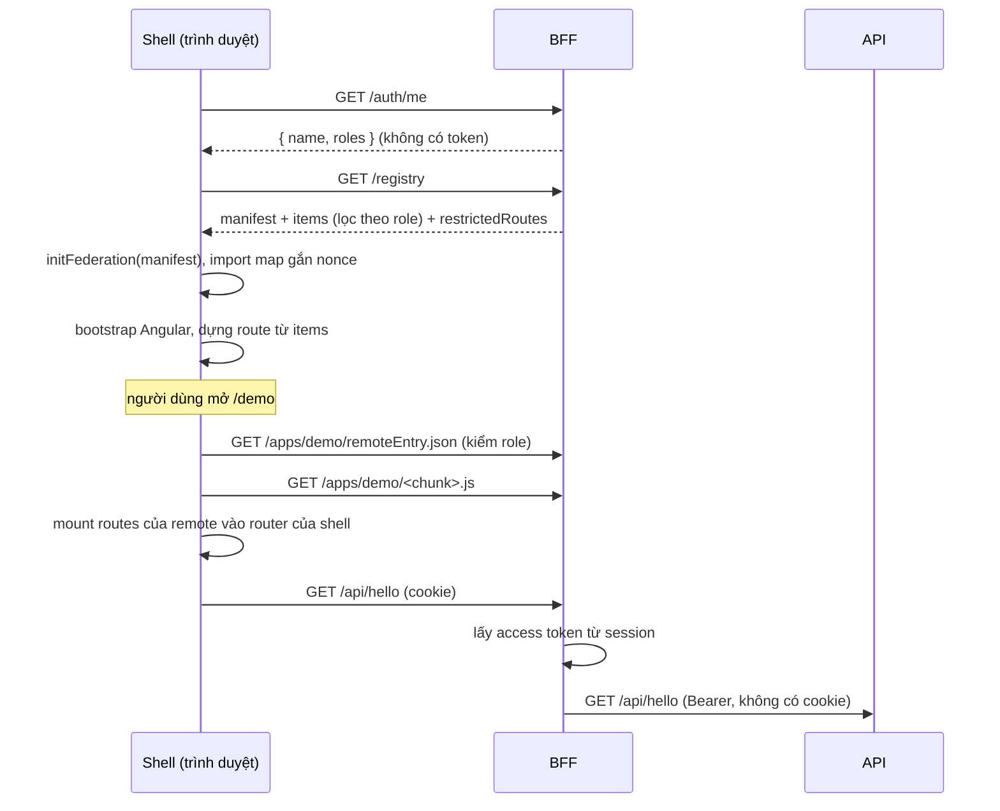

# Kiến trúc

## Tổng quan

Trình duyệt chỉ nói chuyện với một origin duy nhất là BFF (`http://localhost:4000`). BFF đóng ba vai trò:

1. **OIDC client** với Keycloak (Authorization Code + PKCE). Token chỉ nằm trong session phía server.
2. **Gateway**: phục vụ shell và các remote cùng origin, proxy `/api/*` tới upstream kèm access token.
3. **Lớp security**: đặt CSP có nonce, Trusted Types, HSTS và các header khác, kiểm CSRF, giới hạn tần suất gọi `/auth/*`.

Shell là host Angular dùng Native Federation ở chế độ dynamic host. Danh sách remote được lấy từ `/registry` lúc chạy, nên muốn thêm hoặc gỡ remote chỉ cần sửa registry, không phải build lại shell.

## Luồng đăng nhập

```mermaid
sequenceDiagram
  participant B as Trình duyệt
  participant F as BFF :4000
  participant K as Keycloak :8080
  B->>F: GET /demo (chưa có session)
  F-->>B: 302 /auth/login?returnTo=/demo
  B->>F: GET /auth/login
  F->>F: tạo state, nonce, code_verifier (lưu trong session tạm)
  F-->>B: 302 tới Keycloak (code_challenge S256)
  B->>K: đăng nhập
  K-->>B: 302 /auth/callback?code&state
  B->>F: GET /auth/callback
  F->>K: đổi code lấy token (kèm code_verifier, client secret)
  F->>F: kiểm state, nonce, chữ ký ID token; regenerate session
  F-->>B: 302 /demo + Set-Cookie __Host-sid (HttpOnly) + XSRF-TOKEN
```

- Khi đăng xuất, shell gửi `POST /auth/logout` (có CSRF). BFF huỷ session rồi trả về URL `end_session` của Keycloak, trình duyệt điều hướng tới đó để kết thúc luôn phiên SSO.
- Access token hết hạn thì BFF tự refresh phía server. Mỗi session chỉ refresh một lần tại một thời điểm, vì refresh token được xoay vòng. Refresh thất bại thì session bị huỷ.
- Session có idle timeout 30 phút và absolute timeout 8 giờ (đổi được qua `SESSION_IDLE_MINUTES`, `SESSION_ABSOLUTE_HOURS`).

## Luồng tải remote



- Angular, rxjs, Lit và các lib `@mf/*` được share dạng singleton `strictVersion`. Cả trang chỉ có một bản `@angular/core`, và remote dùng injector của shell (`AuthService`, `HttpClient`).
- Remote nào không tải được (chết, 404, sai hợp đồng, quá 10 giây) thì chỉ vùng nội dung hiển thị trang lỗi, header và sidebar vẫn hoạt động.

## Các quyết định chính

- **Native Federation** thay vì webpack Module Federation, vì Angular 22 build bằng esbuild.
- **BFF giữ token**, vì mọi remote chạy chung `window` với shell. Nếu token nằm trong JavaScript thì remote nào cũng đọc được.
- **Phục vụ remote cùng origin** qua `/apps/<name>/`: không phải xử lý CORS, một CSP dùng chung, và BFF kiểm role trên từng file.
- **CSP dùng nonce cộng Trusted Types**, không dùng `blob:` hay `unsafe-*`. Chi tiết và bằng chứng nằm ở `plans/261019-1206-angular-mf-host-shell/phase-06-shell.md`.
- **Web Components (Lit)** cho design system, và design tokens là CSS variables. Shell đăng ký design system đúng một lần.

## Chế độ phục vụ

- `SERVE_MODE=proxy` (mặc định khi dev): BFF proxy tới dev server của shell (:4200) và remote (:4201), có chèn nonce vào HTML và chuyển tiếp WebSocket cho live reload.
- `SERVE_MODE=static` (mặc định khi `NODE_ENV=production`, và dùng cho e2e): BFF phục vụ bản build trong `dist/apps/*/browser`.
